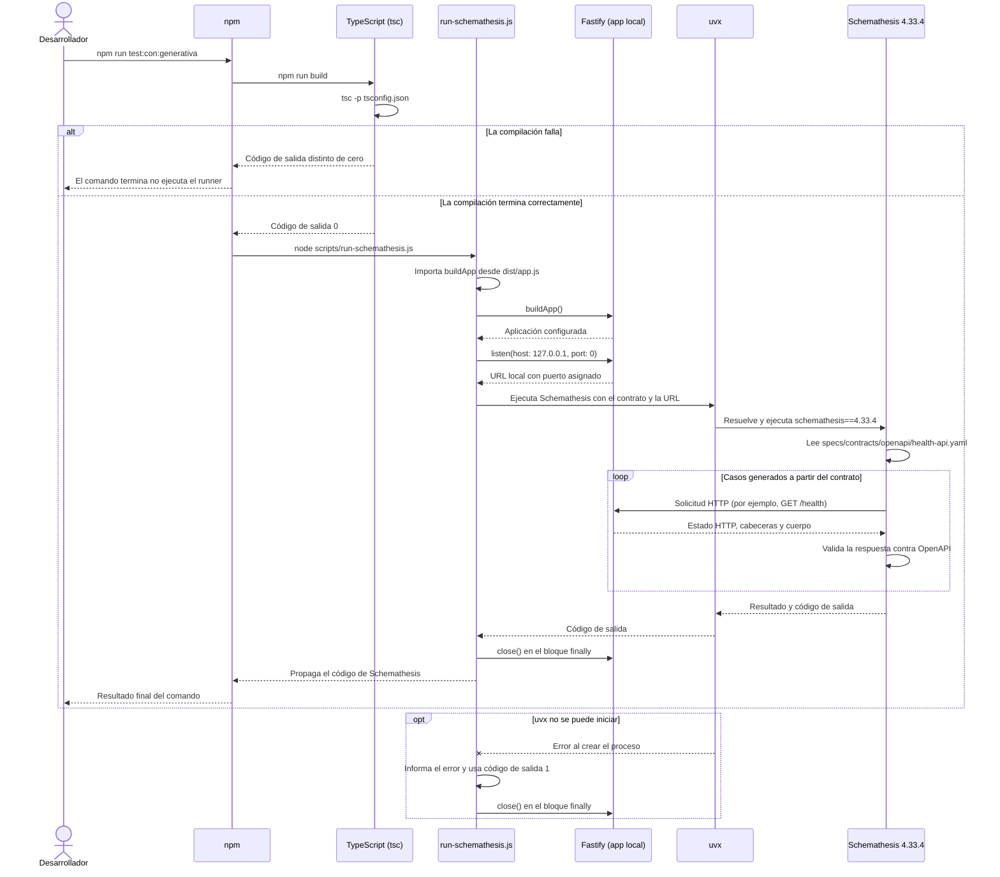

# Prueba de Contrato Generativa con Schemathesis 

Para Pruebas de conformidad de API autogeneradas basadas en contrato o Prueba de Contrato Generativa usamos Schemathesis.
El comando `npm run test:con:gen` compila la aplicación y después ejecuta Schemathesis contra una instancia local temporal de la API. Schemathesis usa el contrato OpenAPI versionado en `specs/contracts/openapi/health-api.yaml` para generar solicitudes y validar las respuestas. `npm run test:con:gen` se conserva como alias compatible.

El comando `uvx` debe estar disponible en el entorno. El runner reserva el puerto con valor `0`, por lo que el sistema operativo asigna uno libre; la instancia se enlaza únicamente a `127.0.0.1` y se cierra al terminar la ejecución.